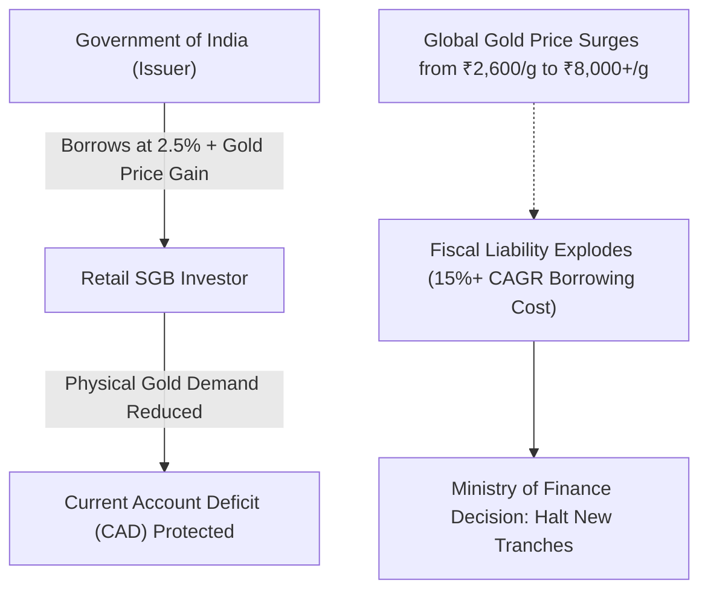

import PostLayout from '../../layouts/PostLayout.astro';
import Callout from '../../components/Callout.astro';
import Cite from '../../components/Cite.astro';
import Mermaid from '../../components/Mermaid.astro';

<PostLayout
  title={frontmatter.title}
  description={frontmatter.description}
  series={frontmatter.series}
  seriesOrder={frontmatter.seriesOrder}
  assetClass={frontmatter.assetClass}
  riskTier={frontmatter.riskTier}
  difficulty={frontmatter.difficulty}
  verifiedOn={frontmatter.verifiedOn}
>

## 1. TL;DR & Quantitative Summary

  

    

      Fresh Primary Issuances
      <strong class="text-base text-red-600 font-mono">Discontinued / Halted</strong>
      Government policy shift
    

    

      Original Subscriber Tax
      <strong class="text-base text-emerald-600 font-mono">0% (Exempt)</strong>
      Section 47(viic) at 8-yr maturity
    

    

      Secondary Buyer Tax
      <strong class="text-base text-amber-600 font-mono">12.5% LTCG</strong>
      Under Section 112 (>12 months)
    

    

      Annual Coupon Rate
      <strong class="text-base text-stone-900 dark:text-stone-100 font-mono">2.50% p.a.</strong>
      Semi-annual, fully taxable
    

  

---

## 2. Why Did the Government Halt New SGB Tranches?

Launched in November 2015 under the Sovereign Gold Bond Scheme, SGBs were designed to achieve one primary macroeconomic objective: **reduce physical gold imports to curb India's persistent Current Account Deficit (CAD)**.

For retail investors, it was heralded as the "Holy Grail" of gold investing:
1. Pure sovereign credit backed by the Government of India via the Reserve Bank of India (<Cite id="RBI" law="Government Securities Act 2006" />).
2. A guaranteed **2.50% annual cash interest** payout paid semi-annually.
3. Complete exemption from capital gains tax upon redemption at the full 8-year maturity under Section 47(viic) of the Income-tax Act.

### The Fiscal Trap: Extremely Expensive Sovereign Borrowing
While plain vanilla Government Securities (G-Secs) allow the Indian government to borrow at a fixed, predictable yield of **6.8% to 7.3%**, SGBs turned into an astronomically expensive borrowing mechanism for the national exchequer.

When gold prices rallied from approximately ₹2,600 per gram in late 2015 to over ₹7,500 – ₹8,200 per gram in recent years, the Government of India was contractually obligated to repay investors the full spot market value of gold at maturity, plus the 2.5% cumulative coupon. On an annualized basis, the government's effective cost of borrowing on maturing early tranches reached **13% to 16% CAGR**—more than double the yield on regular sovereign bonds. 

Faced with mounting fiscal liability and a concurrent sharp cut in customs import duties on gold down to 6%, the Ministry of Finance effectively ceased fresh SGB tranches.

---

## 3. The New Tax Architecture: Original vs Secondary Market Buyers

One of the most consequential developments for existing and prospective bondholders is the clarification in tax treatment between primary and secondary market acquisitions:

| Criterion | Original RBI Subscriber (Held to 8-Yr Maturity) | Secondary Market Buyer (Acquired via NSE/BSE) |
| :--- | :--- | :--- |
| **Capital Gains on Maturity** | **100% Tax Exempt** under Section 47(viic) | **Taxable at 12.5% LTCG** (no indexation) |
| **Premature Exit (RBI Window after 5 Yrs)** | **100% Tax Exempt** under Section 47(viic) | **Taxable at 12.5% LTCG** |
| **Sale on Stock Exchange before Maturity** | Taxable: 20% STCG (&lt;12 months) or 12.5% LTCG (&gt;12 months) | Taxable: 20% STCG (&lt;12 months) or 12.5% LTCG (&gt;12 months) |
| **2.5% Annual Interest** | Taxable at marginal income slab rate | Taxable at marginal income slab rate |

<Callout type="warning" title="No Free Lunch for Secondary Market Buyers">
If you buy an existing SGB on the stock exchange trading at a discount, you cannot claim complete tax immunity upon maturity redemption. Capital gains realized between your acquisition price and the RBI redemption payout are treated as Long-Term Capital Gains taxed at 12.5% under Section 112 (if held for more than 12 months).
</Callout>

---

## 4. Secondary Market Valuation & Discount Arbitrage

Because primary issuances are halted, the only legal pathway to purchase SGBs today is through the secondary market on NSE and BSE (under symbols like `SGBMAY29`, `SGBOCT31`, etc.).

### How SGBs Trade on Exchanges
Secondary SGBs frequently trade at a **1.5% to 6.0% discount** relative to the underlying 24-karat gold spot price published by the India Bullion and Jewellers Association (IBJA). This discount stems from:
1. **Low Secondary Liquidity**: Daily trading volumes for specific tranches are thin, leading to wide bid-ask spreads.
2. **Tax Asymmetry**: Secondary buyers price in the 12.5% LTCG liability that original primary holders did not face.
3. **Time to Maturity**: Bonds with 4 to 6 years remaining to maturity exhibit higher duration and illiquidity discounts.

### Quantitative Yield-to-Maturity (YTM) Equation
To evaluate whether a secondary SGB is more attractive than a Gold ETF, calculate its Effective Net Yield $Y_{\text{net}}$:

$$Y_{\text{net}} = \frac{C + \frac{(P_{\text{gold}} \times (1 - T_{\text{ltcg}})) - P_{\text{market}}}{n}}{P_{\text{market}}}$$

Where:
- $C$ is the annual coupon ($2.5\% \times \text{Issue Price}$).
- $P_{\text{market}}$ is the current exchange purchase price.
- $P_{\text{gold}}$ is the projected spot gold price at maturity.
- $T_{\text{ltcg}}$ is 12.5% applied only on the capital gain $(P_{\text{gold}} - P_{\text{market}})$.
- $n$ is the number of years remaining until the 8-year maturity date.

---

## 5. Alternatives for Gold Allocation Today

With new SGBs off the table, how should Indian investors maintain their 5% to 15% strategic gold allocation?

| Instrument | Sovereign Guarantee | Annual Holding Cost (TER) | Tax on Capital Gains | Liquidity |
| :--- | :--- | :--- | :--- | :--- |
| **Gold ETFs** | None (Vault physical gold backing) | 0.25% – 0.55% p.a. | 12.5% LTCG (&gt;12m) / 20% STCG | **Highest (T+1 intraday)** |
| **Gold Mutual Funds** | None (Invests in Gold ETFs) | 0.40% – 0.85% p.a. (TER) | 12.5% LTCG (&gt;12m) / 20% STCG | High (Mutual Fund NAV) |
| **Secondary SGBs** | **Full GOI Sovereign Guarantee** | **0.00%** (+ earns 2.5% interest) | 12.5% LTCG (&gt;12m) | Low (Fragmented Exchange Tranches) |
| **Physical Bullion (Coins/Bars)** | None (Storage & purity risk) | 3% GST + 1% to 3% locker cost | 12.5% LTCG (&gt;24m) | Medium (Jeweller haircut) |

---

## 6. Artha Atlas Verdict & Action Plan

1. **Do Not Sell Existing SGBs if Originally Subscribed**: If you purchased SGBs directly from the RBI window, holding them to the 8-year mark or the 5-year premature exit window locks in an unbeatable **100% tax-free capital gain** plus sovereign backing.
2. **For New Deployments, Prefer Low-Cost Gold ETFs**: For systematic monthly investments (SIPs), Gold ETFs (TER under 0.30%) offer superior liquidity, instantaneous execution, and transparent price discovery without exchange illiquidity penalties.
3. **Opportunistic Secondary SGB Buys**: Only buy secondary SGBs on the stock exchange if the price discount relative to IBJA spot gold exceeds **4%**, comfortably offsetting the 12.5% LTCG friction upon maturity.

</PostLayout>
